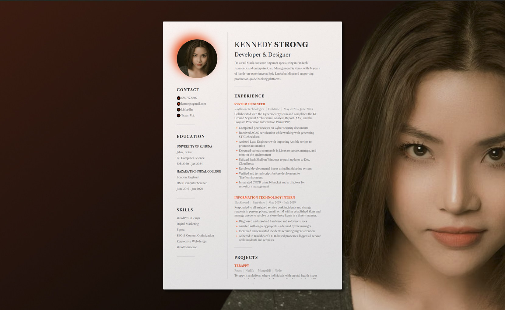
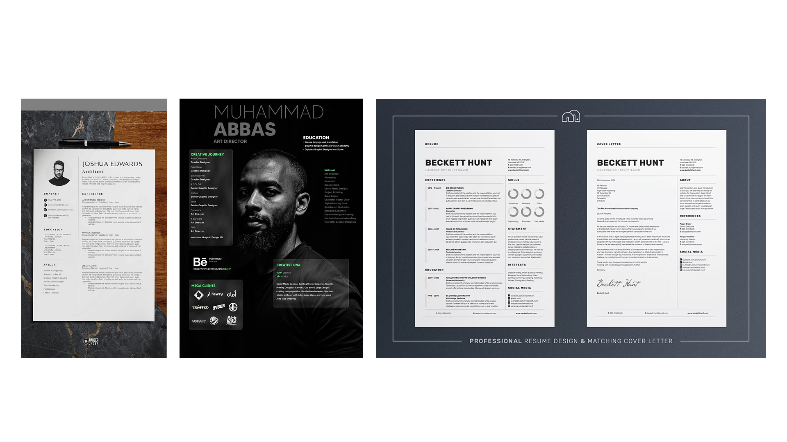
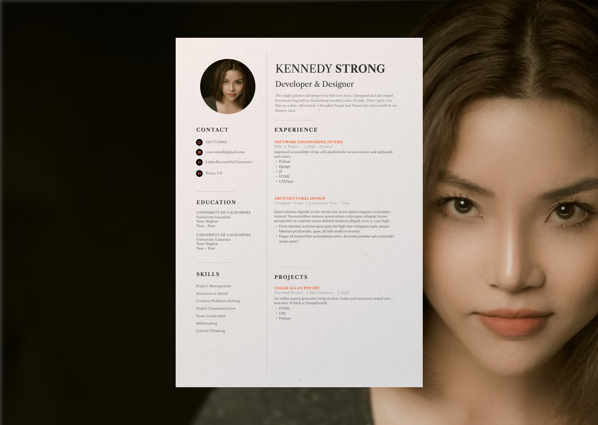

# Professional CV

*Website Mockup*




Curriculum vitae using html and css. The modern cv for the age of the web.

## Description

This project essentially creates the first prototype of a web cv. It has a few cool features like being able to scroll through experience and jobs. Eventually, the goal is to make it like the official business card of the web. See more details in the [SCOPE document](SCOPE.md)

[Project Inspiration](https://roadmap.sh/projects/single-page-cv)

## Process

I began essentially by making a list of the goals I had for the project. The first were inspired by the description of the original project on [roadmap.sh](https://roadmap.sh/projects/single-page-cv), but I also added my own modifications like the usage of CSS.

From there, I wrote out step by step what I would need to do to finish the project. It was like planting goal posts or trail markers for myself ahead of time. Really useful for keeping the scope of the project manageable and rewarding.

### Figma

The first of my steps was designing stuff in Figma. I began with a mood board arranged from my favorite works from other designers across Google, Behance, and Pinterest:

*Mood Board*



Obviously, I decided to borrow heavily from the design on the left of the mood board. Especially the layout.

Thereafter I got to work on making a mockup for my website, which meant making a custom favicon, getting some custom icons from fontawesome and an original headshot from pexels.

*Favicon*


This was really fun to make. I based the original design off of a generic document icon, but then made it my own with custom border-radius.

*Icons*


*Headshot*


I modified the headshot to have a linear gradient background. It just felt more interesting.

Finally, all these element culminated in the website mockup. This thing served as my north star for the rest of the project.

*Site Mockup*



### HTML & CSS

```console
* 948300b (HEAD -> main, origin/main, origin/HEAD) fix: wonky html errors
* 9254d80 feat: create and style projects
* 8ba13e0 feat: rework sizing on page
* 04bbae9 feat: make experience and projects scrollable
* 6526b0d feat: style experience section
* 9aaa17a fix: spacing issues in header
* 22f5857 feat: make cv fade in on page load
* a8db8e8 feat: give softer borders to cv
* d4dacd4 feat: add extensions.md
* 8f69cea feat: hide scrollbars
* ce6fc18 feat: style skills section
* 892dbc0 feat: style education section
* 5a6d7b5 feat: style contact section
* 5013e1a feat: style headshot
* 57fb70e feat: design header
* c2f5d53 feat: add background paper texture
* f56caf3 fix: remove responsiveness to keep same size
* ec6d0a2 feat(styles): make cv fully responsive to zoom and resizing
* 1c1fbde fix: resizing issues with cv
* 8643a74 feat: add box shadow to cv
* 9f4afe7 feat: create and style cv container
* 7b8fc51 feat: code page background
* d15dfbe feat(index): add social media meta content
* 7304c88 feat(index): add SEO meta tags
* 339a808 feat: add site favicon
* 78f526f feat(index): connect script file
* 544223d feat(index): connect css files to index
```

I won't go into all the implementation details. If you're very curious, feel free to go through the commit history and check out the code. That being said, there are some highlights I want to take you through because I think they can be informative for your own projects.

#### The CSS Reset

I always use [Josh Comeau's Modern CSS Reset](https://www.joshwcomeau.com/css/custom-css-reset/) and paste it into a reset.css file in my web projects. He strikes a nice balance between total minimalism and sensible functionality. Here's what it looks like in the file:

```css
/* 1. Use a more-intuitive box-sizing model */
*, *::before, *::after {
  box-sizing: border-box;
}

/* 2. Remove default margin */
*:not(dialog) {
  margin: 0;
}

/* 3. Enable keyword animations */
@media (prefers-reduced-motion: no-preference) {
  html {
    interpolate-size: allow-keywords;
  }
}

body {
  /* 4. Increase line-height */
  line-height: 1.5;
  /* 5. Improve text rendering */
  -webkit-font-smoothing: antialiased;
}

/* 6. Improve media defaults */
img, picture, video, canvas, svg {
  display: block;
  max-width: 100%;
}

/* 7. Inherit fonts for form controls */
input, button, textarea, select {
  font: inherit;
}

/* 8. Avoid text overflows */
p, h1, h2, h3, h4, h5, h6 {
  overflow-wrap: break-word;
}

/* 9. Improve line wrapping */
p {
  text-wrap: pretty;
}
h1, h2, h3, h4, h5, h6 {
  text-wrap: balance;
}

/*
  10. Create a root stacking context
*/
#root, #__next {
  isolation: isolate;
}
```

#### Hiding the Scrollbar
Scrollbars are the bane of my existence. Whenever I can hide them, I will. Here's how to do so on the site level:

```css
body {
  -ms-overflow-style: none;
  scrollbar-width: none;
}

body::-webkit-scrollbar,
body::-webkit-scrollbar-button {
  display: none;
}

html {
  scrollbar-width: none;
}
```

#### Meta Tags
A lot of this project focused on getting the right meta tags on the site. If you're not aware, these tags go in the head section and can be used for a variety of things, from the size of the screen to how they appear in social media and search engines. Here's some code snippets of those:

*Search Engine Tags*

```html
<title>Make Your Professional CV</title>

<meta
  name="description"
  content="A professional cv totally well designed for a working designer/developer."
>

<meta name="robots" content="noindex, nofollow">
```

*OpenGraph (Social Media) Tags*

```html
<meta property="og:title" content="Make Your Professional CV">
<meta property="og:url" content="https://professionalcv.com">
<meta
  property="og:description"
  content="An incredible CV generator that is totally free and open source."
>
<meta property="og:image" content="./images/site-favicon.svg">
```

## Future Extension

If you've made it this far then thanks for checking out the project. It is very much still in its infancy. There's a lot of cool extension ideas in the [EXTENSION.md](EXTENSION.md) file if you're interested!

Cheers!